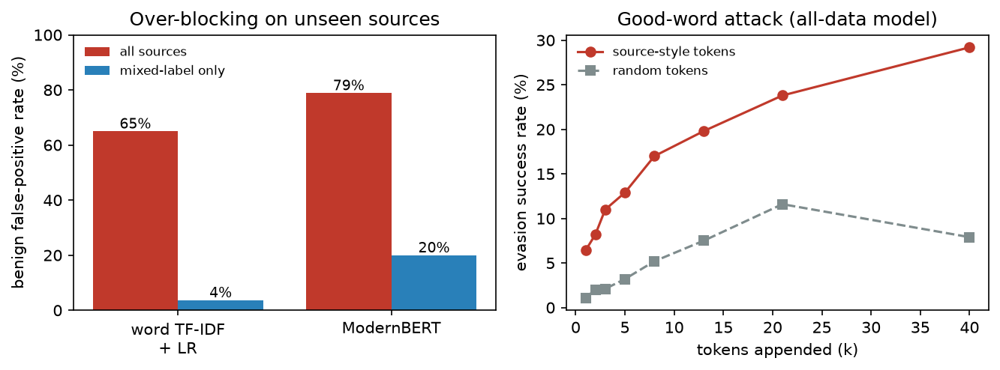

# SkillShift — source shortcuts in malicious agent-skill detection

Agent skills (`SKILL.md` files) extend LLM agents with instructions and scripts, and malicious skills are an emerging supply-chain threat. On [MaliciousSkillBench](https://huggingface.co/datasets/ProtectSkills/MaliciousSkillBench) (9,740 skills from 13 source benchmarks), a text classifier that looks strong on a random split flags **two-thirds of benign skills from sources it was not trained on**. The reason is a *source shortcut*: the model learns which benchmark a skill came from, not whether it is dangerous. This repository traces that mechanism, tests a data fix, shows the same shortcut is an evasion channel an attacker can use, and checks the effect on real skills from public GitHub. The write-up is in [paper/skillshift.pdf](paper/skillshift.pdf). Try the two detectors in your browser: **[live demo](https://huggingface.co/spaces/Aryanwgaf/SkillShift)** (a compact 30k-term version of the linear baseline, run client-side; its scores differ slightly from the paper's).



## Background and prior work

Source-induced label shortcuts are a known artifact. When sources differ in their label mix, models learn to recognise the source instead of the label — documented for dataset identity ("name that dataset"), annotation artifacts in NLI, a pneumonia detector that learned the hospital, and, closest to this setting, Android malware detection, where a store URL became a top "benign" feature (Arp et al., 2022). That merging sources creates the shortcut, and that per-source both-label data is the remedy, is not new and is not claimed here. For malicious agent skills specifically, MaliciousSkillBench reports the unseen-source gap, and SkillScreen reports that detection thresholds do not transfer to unseen benign sources.

What this work adds, in the agent-skill domain, is the decomposition and a tested remedy: a probe showing the source is predictable from text, an ablation separating label-mixing from the benchmark's minimal-pair construction, a dose-response that locates the single source responsible, the symmetry between the over-block and an evasion attack that exploits the same features, and an audit on real GitHub skills. The prior work's remedy is to add more benign sources; the one tested here is to *select* the sources that already contain both labels.

## Data and evaluation

MaliciousSkillBench (CC-BY-4.0; arXiv:2608.19901) merges 13 source benchmarks; most carry a single label. Evaluation uses the frozen `source_disjoint` split, whose test sources (SkillHarm, ATR, SkillFortifyBench) never appear in training, so a detector must generalise to benign skills written in styles it has never seen. The headline metric is the benign false-positive rate (FPR) on these unseen sources — the share of legitimate skills a detector would block. Confidence intervals are 95% paired, class-stratified bootstrap intervals over test examples (2,000 resamples); small per-source groups use exact Clopper-Pearson intervals. The transformers are fine-tuned once per training set (single seed); the classical ablations average three seeds. Every number in the paper is generated from `results/*.json` by `scripts/make_paper_numbers.py`.

## Findings

**1. The over-block reproduces across model classes.** Benign FPR and malicious recall on unseen-source test skills (95% bootstrap CI on FPR; recall at the default 0.5 threshold):

| model | benign FPR | malicious recall | PR-AUC |
|---|---|---|---|
| word TF-IDF + logistic regression, all data | 65% [61–69] | 96% | 0.79 |
| word TF-IDF + LR, mixed-label sources only | **3.7%** [2.2–5.3] | 50% | 0.93 |
| ModernBERT-base (encoder), all data | 79% [76–82] | 98% | 0.66 |
| ModernBERT-base, mixed-label sources only | 20% [17–23] | 53% | 0.79 |
| Qwen2.5-0.5B QLoRA (decoder), all data | 80% [77–83] | 97% | 0.79 |
| Qwen2.5-0.5B QLoRA, mixed-only | 1.8% [0.7–3.1] | 12% | 0.78 |

The over-block holds across a linear model, a fine-tuned encoder, and a 4-bit QLoRA decoder, so it is a property of the data rather than any one architecture. The fix trades malicious recall at a fixed threshold for the FPR drop. On the two fully-trained models it also improves ranking (word-LR PR-AUC 0.79→0.93, recall at a 2% false-alarm budget (oracle threshold) 8%→46%; ModernBERT 0.66→0.79), so at any fixed low false-alarm rate the fixed model catches far more — a simple linear model with the right data out-ranks a fine-tuned transformer with the wrong data. Recall in the table is read at the fixed 0.5 threshold, which is not calibrated across models. The ranking gain does not appear on the single-epoch 0.5B decoder (PR-AUC 0.79 vs 0.78), so its low mixed-only recall is a conservative operating point on an essentially unchanged ROC, not a capability ceiling; the decoder row confirms the over-block is architecture-general.

**2. The model learns the source, not the label.** A TF-IDF probe predicts a skill's *source benchmark* from its text at 91.7% accuracy (76% balanced, chance 10% over 10 sources). Tokens like `openclaw` — platform boilerplate — act as "benign" cues only because of how the benchmark's sources were mixed; inside the one source that holds both labels at scale, the token carries no signal about maliciousness.

**3. The fix is which data, not less data.** Training only on sources that contain both labels is what removes the shortcut. A size-matched random subset of all-data stays at 58% benign FPR, and re-weighting every (source, label) group equally does not help, so the gain is not from using fewer examples. Ablations locate it in label-mixing rather than the benchmark's minimal-pair construction, trace the collapse to the largest single-label malicious source, and show that masking the `openclaw` token or stripping YAML frontmatter does not close the gap — the shortcut is distributed across the text.

**4. The same shortcut is an attack surface.** Appending 8 of the linear detector's own benign source-style tokens to a malicious skill evades it 17% of the time, against 5% for the same number of random tokens (a good-word attack); the fix lowers this to 7%. One bias produces both failures — over-blocking benign skills and letting malicious ones slip through — and one data choice moves both.

**5. The divergence survives on real skills.** On 400 public GitHub `SKILL.md` files (32% of which contain the `openclaw` token), the all-data detector flags 30% as malicious and the fixed one flags 5%. These files are unlabeled, so this measures the over-block divergence in the wild, not a calibrated false-positive rate; the benchmark finding is not an artifact of its curated benign sources.

## Scope and limitations

The central result — merging single-label sources creates an over-block, and selecting the mixed-label sources removes it — holds across three architecture classes at roughly a 17× effect (65% → 3.7% FPR), far larger than any source of noise below. These bound where it has been tested and name the experiment that extends each edge; none of them threaten the direction of the result.

- **Single-seed transformers, bounded by a multi-seed control.** The ModernBERT and QLoRA runs are one seed each, with confidence intervals over test examples. The one model trained across three seeds, the linear ablation, reproduces the same 65% → 4% collapse, and the transformer effects (79% → 20%, 80% → 1.8%) are far larger than fine-tuned-transformer seed variance typically is. Multi-seed runs would narrow the interval, not move the conclusion.
- **The decoder tests generalization of the over-block, not of the ranking gain.** The 0.5B QLoRA run is a deliberately small, single-epoch model, included to show the over-block spans architecture classes, which it does decisively (80% → 1.8% FPR). The ranking gain is a separate claim, established on the two fully-trained models; the decoder's flat PR-AUC (0.79 → 0.78) is the expected outcome at that budget, not a failed run. Whether a ranking gain emerges with scale is the natural next experiment.
- **The GitHub audit measures divergence by design.** On 400 real, uncurated skills the two detectors disagree by roughly 6× (30% vs 5% flagged), which establishes that the shortcut is not an artifact of the benchmark's curated benign sources. It reports divergence rather than a calibrated FPR because the skills are unlabeled; hand-labeling that set is the one step that turns divergence into a field precision number.
- **Established on one benchmark family; the mechanism predicts the rest.** All results use MaliciousSkillBench's `source_disjoint` split, where the unseen benign test set is small and ATR-dominated and "mixed-only" reduces in practice to training on SkillTrustBench. The claim is mechanistic (single-label merging creates the shortcut, mixed-label selection removes it), so it should transfer to any similarly merged benchmark; a leave-one-source-out evaluation across skill benchmarks is the direct test, and the pipeline runs it unchanged.
- **Prevalence is why FPR, not accuracy, is the headline.** The benchmark is 77% malicious while real registries are overwhelmingly benign, so precision at field prevalence sits below any accuracy figure here. FPR is reported precisely because it is prevalence-independent and composes with a deployment's own base rate.

## Reproduce

```bash
uv sync
uv run python -c "from huggingface_hub import snapshot_download; snapshot_download('ProtectSkills/MaliciousSkillBench', repo_type='dataset', local_dir='data/raw/msb')"
uv run python scripts/baselines.py        # baselines across the three splits
uv run python scripts/shortcut_probe.py   # source is predictable from text
uv run python scripts/robust_classical.py # the mixed-only fix + controls
./scripts/run_transformer_suite.sh        # ModernBERT fine-tune (both training sets, seed 0)
uv run python scripts/mechanism.py        # pairing / dose-response / masking ablations
uv run python scripts/compare_models.py   # all models, paired bootstrap CIs
uv run python scripts/adv_evasion.py      # good-word evasion attack (dose-response)
uv run python scripts/github_audit.py     # audit on public GitHub skills
uv run python scripts/train_lora.py --help   # QLoRA decoder fine-tune (GPU; see docs/RUN_ON_GPU.md)
```

The decoder rows (`results/transformer/lora_*`) were produced on a cloud T4; `docs/RUN_ON_GPU.md` has the runbook.

## Serve

The released scanner is the mixed-only ModernBERT, exported to int8 ONNX; see [docs/MODEL_CARD.md](docs/MODEL_CARD.md) for its operating threshold and calibration caveat.

```bash
uv run python scripts/export_onnx.py --run modernbert_source_disjoint_mixed_only_s0  # -> models/serve/ (int8)
docker build -t skillshift . && docker run -p 8000:8000 skillshift                   # FastAPI + ONNX Runtime
curl http://localhost:8000/healthz
```

## Citing this work

```bibtex
@misc{skillshift2026,
  title  = {Source Shortcuts in Malicious Agent-Skill Detection: Why Detectors Fail on Unseen Sources, and What the Fix Really Learns},
  author = {Bhargava, Aryan},
  year   = {2026},
  howpublished = {\url{https://github.com/Aryanbhargava18/SkillShift}}
}
```

## License

Code is released under the MIT License ([LICENSE](LICENSE)). The MaliciousSkillBench dataset is CC-BY-4.0 and is not redistributed here; the reproduce step downloads it from its source.
